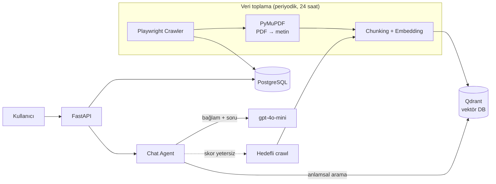

<div align="center">

# UniLex AI

**Üniversite mevzuatını doğal dilde sorgulanabilir hale getiren, kaynak göstererek yanıt veren yapay zekâ asistanı.**


</div>

---

## Problem

Üniversite yönetmelikleri ve yönergeleri uzun, karmaşık PDF belgelerinde dağınık biçimde yayımlanır. "Çift anadal başvurusu için GNO şartı nedir?" gibi basit bir soruyu yanıtlamak için bile birden fazla belgeyi okumak ve karşılaştırmak gerekir.

## Çözüm

UniLex AI resmi belgeleri otomatik toplar, anlamsal olarak indeksler ve öğrenci sorularını **yalnızca bu belgelere dayanarak, kaynağını göstererek** yanıtlar. Yanıtta bulunamayan bilgi için sistem kendiliğinden o soruya özel yeni belge arar.

| | |
|---|---|
| **36** | REST endpoint |
| **7** | Veritabanı tablosu, **6** Alembic migration |
| **81** | Otomatik test (pytest) |
| **~3.9K** | Satır Python (backend) |
| **3** | Docker servisi (PostgreSQL, Qdrant, API) |

---

## Mimari



### Bir soru nasıl yanıtlanır?

1. **Üniversite tespiti:** Oturumda üniversite henüz seçilmediyse mesajdan LLM ile bulunur ve veritabanındaki kayıtla eşleştirilir. Selamlaşma ve sohbet mesajları RAG'a girmeden doğrudan yanıtlanır.
2. **Anlamsal arama:** Soru vektöre çevrilir, Qdrant'ta **o üniversiteye ait** parçalar arasında en yakın 5 parça getirilir.
3. **Alaka filtresi:** Benzerlik skoru **0.60** altındaki parçalar elenir, böylece model alakasız bağlamla halüsinasyon üretmez.
4. **Yanıt:** Kalan parçalar bağlam olarak `gpt-4o-mini` modeline verilir. Yanıt, kullanılan belgenin adı ve bağlantısıyla birlikte döner.
5. **Agentic fallback:** Eşik aşılamazsa ya da yanıt "bilgi yok" ise sistem soruya özel bir **hedefli crawl** başlatır, bulduğu belgeyi indirip indeksler ve soruyu bir kez daha dener. Yine bulamazsa kullanıcıya resmi mevzuat bağlantısını gösterir.

---

## Teknik kararlar

| Konu | Karar | Neden |
|------|-------|-------|
| Chunking | 800 kelime, 100 kelime örtüşme | Madde bütünlüğünü korur, sınırdaki cümlelerin kaybolmasını önler |
| Bozuk PDF metni | Türkçe karakter düzeltme (`İ Ö Ü Ç Ğ Ş`) ve `/uniXXXX` kodlu metin için karakter limiti | Birçok resmi PDF kodlama hatasıyla çıkar, aksi halde embedding kalitesi düşer |
| Yeniden embed | Belge yeniden işlenirken eski parçalar silinir | Yinelenen ya da eskimiş parça kalmaz, işlem tekrar çalıştırılabilir (idempotent) |
| Eskiyen belgeler | Yeniden taramada artık bulunmayan belgeler silinir. **Silinecek belge oranı %80'i aşarsa silme iptal edilir ve uyarı logu yazılır** | Hatalı bir crawl tüm bilgi tabanını yanlışlıkla silemez |
| Çok üniversite | Vektör aramasında `university_id` filtresi | Bir üniversitenin sorusuna başka bir üniversitenin mevzuatı karışmaz |
| Gözlemlenebilirlik | Yapılandırılmış JSON loglama, operasyon bazlı süre ve alan kaydı, loglar `system_logs` tablosunda | Admin panelinden crawl ve sorgu davranışı izlenebilir |
| Şema yönetimi | Alembic migration'ları, konteyner açılırken otomatik `upgrade head` | Veritabanı değişiklikleri sürümlenir ve tekrarlanabilir |
| Kimlik doğrulama | JWT (HS256, 7 gün), bcrypt, e-postayla şifre sıfırlama (30 dk token) | Standart ve denetlenebilir güvenlik modeli |

---

## Özellikler

- **Sohbet:** Çoklu oturum, geçmiş, yanıt yenileme, mesaj başına kaynak belge kaydı
- **Geri bildirim:** Yanıt başına "Yararlı / Yararlı değil" puanı ve yorum, yönetici için olumsuz geri bildirim listesi
- **Yönetici paneli API'si:** İstatistikler, kullanıcı ve belge yönetimi, kullanıcıyı yönetici yapma, sistem logları, yük grafiği verisi
- **Crawler yönetimi:** Manuel tarama ve embed tetikleme, iş durumu sorgulama (arka planda, `202 Accepted`)
- **Hesap yönetimi:** Profil güncelleme, şifre sıfırlama, **hesap ve tüm sohbet verisinin kalıcı silinmesi** (KVKK silme hakkı)
- **Periyodik güncelleme:** APScheduler ile her 24 saatte bir otomatik yeniden tarama

---

## API

Etkileşimli dokümantasyon: `http://localhost:8000/docs` (Swagger UI)

| Grup | Endpoint | Kapsam |
|------|:-------:|--------|
| `auth` | 4 | Kayıt, giriş, şifre sıfırlama |
| `chat` | 6 | Oturumlar, mesaj gönderme, yanıtı yeniden üretme, oturum silme |
| `users` | 4 | Profil, avatar yükleme, hesap silme |
| `universities` | 3 | Üniversite listeleme, detay ve ekleme |
| `documents` | 3 | Belge listeleme, görüntüleme ve PDF yükleme |
| `feedback` | 5 | İletişim formu, yanıt değerlendirmesi, yönetici listeleri |
| `admin` | 8 | İstatistik, kullanıcı, belge, log, yük geçmişi |
| `crawler` | 3 | Tarama ve embed tetikleme, durum |

---

## Teknoloji

| Katman | Teknoloji |
|--------|-----------|
| API | FastAPI, Pydantic v2, Uvicorn |
| LLM ve embedding | OpenAI `gpt-4o-mini`, `text-embedding-3-small` (1536 boyut) |
| Vektör veritabanı | Qdrant |
| İlişkisel veritabanı | PostgreSQL 16, SQLAlchemy 2.0, Alembic |
| Crawler | Playwright (Chromium), PyMuPDF |
| Zamanlayıcı | APScheduler |
| Güvenlik | JWT (`python-jose`), bcrypt |
| Altyapı | Docker, Docker Compose |

---

## Kurulum

**Gereksinim:** [Docker Desktop](https://www.docker.com/products/docker-desktop/)

```bash
git clone https://github.com/OktayKorkut/unilex-ai.git
cd unilex-ai
cp backend/.env.example backend/.env
```

`backend/.env` içinde en az şu iki değeri doldurun:

```env
OPENAI_API_KEY=sk-...
SECRET_KEY=...        # openssl rand -hex 32
```

```bash
docker compose up --build
```

| Servis | Adres |
|--------|-------|
| API ve Swagger | http://localhost:8000/docs |

> **SMTP (isteğe bağlı):** Şifre sıfırlama e-postası için `SMTP_HOST`, `SMTP_USER`, `SMTP_PASSWORD`, `SMTP_FROM` değerlerini ekleyin. Boş bırakılırsa sıfırlama token'ı backend loguna yazılır.

---

## Testler

```bash
cd backend
pip install -r requirements-dev.txt
pytest
```

Testler PostgreSQL, Qdrant ya da OpenAI'a **bağlanmaz**: veritabanı için geçici SQLite, dış servisler için sahte istemciler kullanılır. API anahtarı gerekmez, internetsiz çalışır.

| Alan | Neyi doğrular |
|------|---------------|
| Chunking | Boyut, örtüşme, tüm kelimelerin kapsanması, karakter üst sınırı |
| Türkçe kodlama | Bozuk PDF aksanlarının onarımı, idempotentlik |
| Güvenlik | bcrypt, JWT imza/süre/sahtecilik, şifre sıfırlama token'ının tek amaçlı olması |
| Sohbet ajanı | 0.60 alaka eşiği (sınır dahil), eşik altında LLM'e gitmeme, üniversite filtresi, geçmiş kırpma |
| Belge temizliği | %80 güvenlik eşiği (alt, tam ve üst sınır), diğer üniversiteye dokunmama, Qdrant hatasına dayanıklılık |
| API | Kayıt/giriş, kullanıcı varlığının sızmaması, yetkisiz erişim, şifre sıfırlama, hesap silme |

Testlerin gerçekten hata yakaladığı, kasıtlı olarak koda hata sokularak (mutasyon) doğrulanmıştır.
Henüz kapsanmayanlar: Playwright crawler'ı, Qdrant ile gerçek embedding ve sohbet endpoint'leri.

---

## Proje yapısı

```
backend/
├── alembic/            # Veritabanı migration'ları
├── tests/              # pytest testleri
└── app/
    ├── agent/          # Sohbet ajanı, üniversite tespiti ve keşfi
    ├── api/routers/    # REST uç noktaları (auth, chat, admin, ...)
    ├── core/           # Ayarlar, güvenlik, loglama, zamanlayıcı
    ├── crawler/        # Playwright tabanlı tarayıcılar
    ├── db/             # SQLAlchemy modelleri, seed
    ├── rag/            # Embedding ve vektör arama
    └── services/       # İş mantığı (sohbet, crawl işi, e-posta, loglama)
```

---

## Yol haritası

- [ ] Yeni web arayüzü (sıfırdan yeniden geliştiriliyor)
- [ ] Crawler, embedding ve sohbet endpoint'leri için testler
- [ ] Birden fazla üniversite için veri seti (mimari hazır, şu an Işık Üniversitesi tanımlı)

---

## Geliştirici

**Oktay Korkut** · [GitHub](https://github.com/OktayKorkut)

Işık Üniversitesi COMP/SOFT 4902 Mezuniyet Tasarım Projesi kapsamında geliştirilmiştir.
